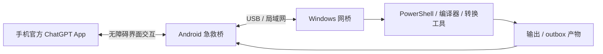

# PhoneRescue · 电脑急救桥

**让手机上的官方 ChatGPT App，通过 USB 操作你的 Windows 电脑。**

电脑断网、开发环境出问题时，用手机网络继续与模型对话；电脑负责执行命令、编译程序、转换文件，再把结果交回手机。无需 API Key，也不提取或反代手机客户端的登录凭证。

作者：**lftph6** · [MIT License](LICENSE) · 当前版本：**0.3.0（实验阶段）**

## 能做什么

- **官方 App 自动循环**：读取 ChatGPT 回复 → 执行诊断/经确认的命令 → 自动发回结果。
- **电脑任务**：用电脑已有工具编译、运行、检查错误，或转换文件格式。
- **文件往返**：手机上传原件，电脑加工，产物保存回手机，单文件最多 100 MB。
- **简单连接**：USB 四位数字配对；自动建立并恢复 ADB 转发。
- **手动备用入口**：Android 可粘贴/分享命令；iPhone 可通过局域网网页执行命令和传文件。



手机访问 ChatGPT 需要网络；USB 传输和电脑加工可以离线。支持的编程语言、文件格式取决于电脑已有工具。官方 App 界面改变可能影响自动化。

## 快速开始

需要 Windows x64、Android 8.0+、支持传数据的 USB 线。电脑端便携版自带 .NET 运行时，不需要预装 Python/Node 才能运行网桥。

1. 从本仓库 **Releases** 下载 `PhoneRescue-Windows-x64.zip` 和 `PhoneRescue-0.3.apk`。如果尚无 Release，请按[构建指南](docs/BUILD.md)自行生成。
2. 解压 Windows 包，安装 APK。在手机开启 USB 调试，连线并允许调试授权；部分手机需要厂商 USB 驱动。
3. 双击 Windows 包内的 `start-usb.cmd` 并保持运行。程序会等待手机、建立转发并传入配对信息；若未自动连接，运行 `connect-usb.cmd`，或在手机“连接”页输入电脑显示的四位码。
4. 在手机“连接”页开启“电脑急救桥 · 自动维修”无障碍服务。打开 ChatGPT，建立空白对话。
5. 返回“任务”页，先勾选只读模式，填写：`只执行一次 system 检查，然后总结。` 点击“开始自动循环”，保持手机解锁、ChatGPT 前台。

更新 APK 后，部分手机需要重新开启无障碍服务。USB 的四位码每次电脑端重启都会变化，可能以 0 开头。

## 编译程序或转换文件

1. 在“文件”页选文件上传；它会进入电脑工作区 `inbox` 的独立子目录。
2. 在“任务”页选“编译并运行”或“转换文件”模板，补充语言、目标格式和验收要求。模板会允许模型提出自定义命令。
3. 模型先检查工具、文件，再给出命令；**自定义 PowerShell 命令需要逐步确认**。
4. 完成后在“文件”页刷新，找到 `outbox` 产物，点击“保存到手机”。

默认工作区为 `%LOCALAPPDATA%\PhoneRescue\workspace`。原件与产物不会自动清理。建议先用无重要内容的小文件试运行。

## 文档导航

| 文档 | 用途 |
| --- | --- |
| [使用指南](docs/USER_GUIDE.md) | USB、局域网、文件、手动模式、故障排查 |
| [自动任务协议](AUTOMATION.md) | ChatGPT 自动循环及限制 |
| [构建与签名](docs/BUILD.md) | 从干净源码构建 Windows、APK、测试包 |
| [Agent 使用指南](docs/AGENT_USAGE.md) | 用 CLI / HTTP 调用电脑网桥 |
| [HTTP API](docs/API.md) | 接口、错误码、幂等和文件协议 |
| [架构说明](docs/ARCHITECTURE.md) | 源码位置、状态机与扩展点 |
| [AGENTS.md](AGENTS.md) | 编码 agent 的项目规则、命令和验证要求 |
| [贡献指南](CONTRIBUTING.md) | 提交问题和改动 |
| [验证记录](VALIDATION.md) | 已测试和未验证的范围 |
| [发布指南](docs/RELEASING.md) | 上传 GitHub、签名、生成 Releases |

## 能力边界

- 网桥以当前 Windows 用户权限运行，**不是命令沙箱**；HTTP 客户端可以直接提交命令，Android 的确认框不是服务器端审批机制。
- USB 模式仅监听 `127.0.0.1`，四位码用于本人操作的本地连接，不用于抵御本机恶意程序。
- 局域网模式使用长凭证和明文 HTTP，仅用于可信网络；不应转发到公网。
- 不自动提权；取消/超时会尝试结束进程树，不会撤销已经发生的修改。
- 不包含 iPhone USB 自动化、DeepSeek 完整界面适配、私有接口反代或云端中继。
- 项目与 OpenAI、Google、Microsoft 无隶属关系。模型、SDK、ADB 和运行时遵循各自条款。

## 从源码开始

Windows 开发机需 .NET 10 SDK、Python 3.10+；构建 APK 另需 JDK 17 和 Android SDK Platform 35 / Build Tools 35.0.0。

```powershell
# 已配置工具链后，构建并运行电脑集成测试
powershell -ExecutionPolicy Bypass -File scripts/build.ps1 -Test

# 生成可分享源码压缩包（不含密钥、日志、SDK、二进制）
python scripts/export_source.py
```

详见[构建指南](docs/BUILD.md)。发布包与源码分开管理，`release/` 不提交 Git。
