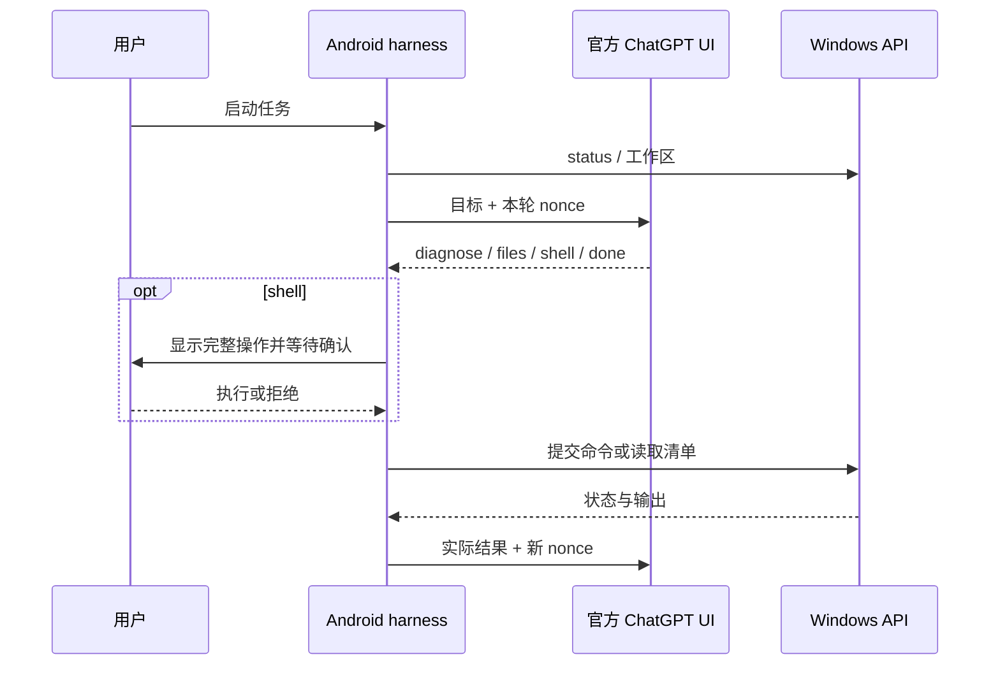

# 架构与扩展点

## 组件

| 组件 | 源码 | 职责 |
| --- | --- | --- |
| Windows server | `Program.cs` | 认证、单任务调度、PowerShell 子进程、日志、文件工作区 |
| Android UI | `MainActivity.java` | 任务/文件/连接/高级页面、SAF 文件选择和保存、HTTP 流式传输 |
| Accessibility harness | `RepairService.java` | 前台 app 检查、填入发送、回复稳定性、操作审批、轮询与回传 |
| Model protocol | `RepairProtocol.java` | 固定检查目录、提示词、nonce、JSON 校验与输出压缩 |
| Browser fallback | `wwwroot/` | 同源网页的手动命令与文件传输 |
| Agent CLI | `scripts/bridge_cli.py` | 无界面的同一 HTTP 客户端 |

Java 文件位于 `android/src/local/phonerescue/app/`。

## 数据路径

文件本体走手机—电脑通道；发送给模型的是路径、清单和经过长度限制的命令输出。工作区、日志、配对会话位于用户 LocalApplicationData。电脑服务不访问模型供应商。

## 状态与中断

服务阶段包括 checking、fill、send、reply、approval、job、idle。`epoch` 区分会话，旧异步回调不得推进新会话。停止会移除轮询、关闭审批并尝试取消当前电脑作业；用户重新开始需要显式操作。

发送只点击一次，避免网络或界面延迟导致重复请求。完整且稳定的 nonce 响应才被解析。UI 树按总节点数限制遍历，避免 Compose 深层输入框被浅层阈值漏掉。只在运行中读取所选聊天 app，其他 app 前台时暂停。

## 扩展建议

- 增加固定诊断：更新 `RepairProtocol.CHECKS` 和测试。只加入范围明确的只读检查，不能把模型传入字符串拼进固定检查。
- 新编译器/格式：优先改任务模板、工具发现和提示词。现有 shell 足以调用本机工具，不必给每种格式添加专属 API。
- 新结构化操作：同时修改协议校验、执行器、权限行为和测试，不能只让 prompt 宣称支持。
- 新聊天 App：分离输入框/发送按钮/停止按钮识别，使用真实设备验证；不提取私有 token。
- 大文件/续传：需明确临时文件、校验、覆盖和失败恢复协议，不能只放大内存缓冲。

## 当前限制

没有持久任务数据库、任务队列、服务器端审批系统或命令沙箱。多个客户端共享单个执行槽。文件列表有上限，命令输出与模型上下文也有长度限制。长时间构建受 300 秒单命令、15 分钟手机会话上限约束。
